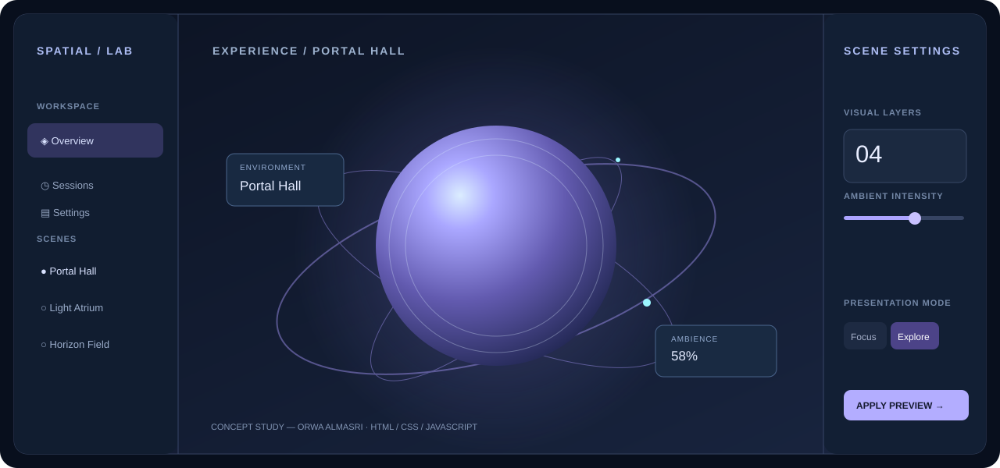

# Orwa Almasri

**Creative Technology · Digital Interfaces · Virtual Reality · Web Systems**

I work at the intersection of digital experiences and technical implementation. My background includes VR experience operations, website and hosting technologies, computer and network systems, and visual production. I enjoy combining clear information design with practical, interactive experiences.

📍 Malaysia · 🌍 Remote collaboration · ✉️ [Contact me](mailto:orwaalmasri@gmail.com)

## Selected concept — Spatial / Experience Control

A self-initiated, **AI-assisted interface design exercise** exploring controls for immersive environments. It demonstrates responsive layout, visual hierarchy, interaction states, scene selection, ambient-intensity controls, and accessible UI implementation. This is a concept, not a completed commercial project.

- **Explore the source:** [`index.html`](index.html)
- **Design focus:** Spatial UX, responsive web interfaces, interaction details
- **Built with:** HTML, CSS, JavaScript, vector illustration
- **Controls:** Scene switching, presentation modes, ambience adjustment, motion preference

## Technical background

- **Creative technology:** Virtual reality environments and public-facing immersive systems
- **Digital production:** Adobe Photoshop, visual layouts, web page composition
- **Web & software:** HTML/CSS, PHP, SQL, Visual Basic, web hosting and infrastructure
- **IT systems:** Windows, Linux, network support, and systems troubleshooting
- **Workflow tools:** AI-assisted digital production and automation concepts

## More information

- **Digital services overview:** [Layla Worldwide](https://laylaworldwide.netlify.app)
- **Contact:** [orwaalmasri@gmail.com](mailto:orwaalmasri@gmail.com)

---

*This profile intentionally presents public-facing concepts and general technical background only. Proprietary and private project code is not published.*